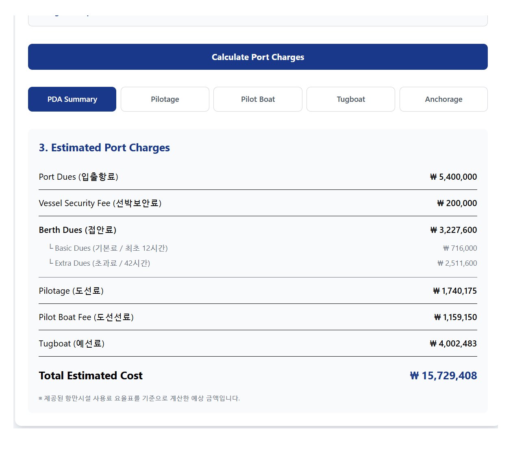
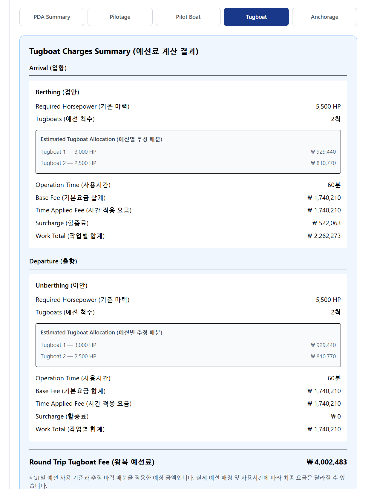
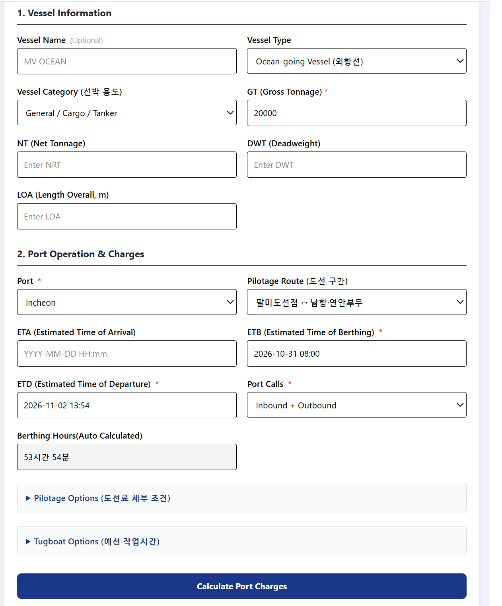
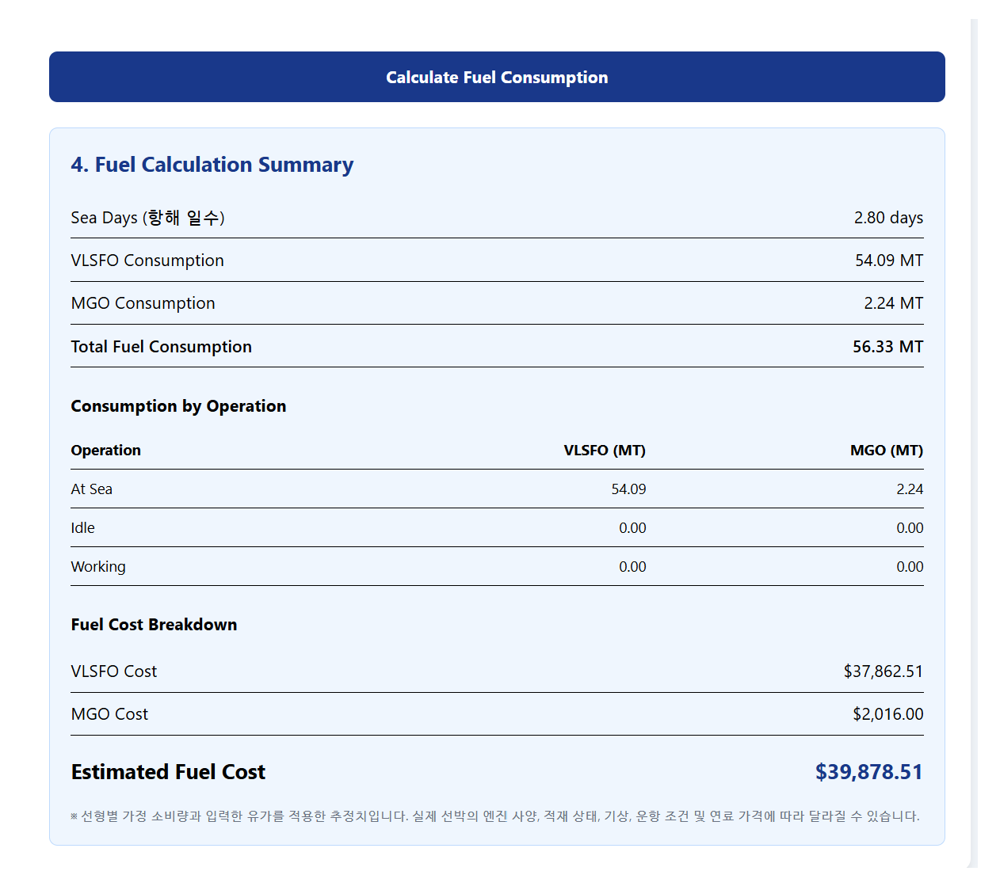

# Maritime Cost Calculator

### 선박 예상항비 및 벌크선 연료 소비량 계산기 (React 기반 사이드 프로젝트)

## 1. Project Overview (프로젝트 소개)

본 프로젝트는 React 기반 웹 애플리케이션 개발 학습과 해운 실무에서 활용되는 비용 산정 로직의 프로토타입 구현 을 목적으로 개발한 개인 사이드 프로젝트입니다.

해운대리점에서 선박 Operation 및 Agency 업무를 수행하면서 선박 입출항에 필요한 예상항비(PDA, Proforma Disbursement Account)를 산정하고, 선주 및 관계자에게 관련 비용을 보고했던 경험을 바탕으로 기획하였습니다.

실제 업무에서는 항만시설 사용료, 도선료, 예선료 등을 계산하기 위해 여러 기관의 요율표 및 견적서를 개별적으로 확인해야 하는 번거로움이 있습니다.

이러한 문제를 개선하기 위해 **여러 항비 항목을 하나의 웹 애플리케이션에서 계산하고, 산정 근거와 상세 결과를 확인할 수 있도록** 구현하였습니다.

또한 선박 운항비용에서 중요한 비중을 차지하는 연료비를 추정하기 위해 Bulk Carrier Fuel Estimator 기능을 추가하였습니다.

현재 애플리케이션은 두 가지 독립적인 계산 기능을 제공합니다.

- **Port Cost Calculator**: 인천항 기준 선박 예상항비 산정
- **Bulk Carrier Fuel Estimator**: 벌크선의 항해·정박·하역 연료 소비량 및 예상 연료비 산정

---

## 2. Main Features (주요 기능)

### 2.1 Port Cost Calculator (예상항비 계산)

- **Port Dues (선박입출항료)**: 선박 총톤수(GT) 및 입출항 횟수에 따른 요금 산출
- **Vessel Security Fee (선박보안료)**: 외항선 총톤수 및 입출항 횟수 기준 계산
- **Berth Dues (접안료)**: 접안시간과 선박 구분에 따른 기본료·초과료 계산
- **Pilotage (도선료)**: 도선구간, 선박 제원, 접·이안 및 할증 조건에 따른 예상 도선료 산출
- **Pilot Boat Fee (도선선료)**: 도선선 이용에 따른 예상 비용 산출
- **Tugboat (예선료)**: 예선 사용 기준과 작업시간에 따른 예상 비용 계산
- **Anchorage Dues (정박료)**: 정박시간에 따른 기본료·초과료 및 벙커링 면제 조건 적용
- **PDA Summary**: 항목별 예상 비용 및 총 예상항비 제공

### 2.2 Bulk Carrier Fuel Estimator (벌크선 연료 계산)

벌크선의 DWT, 항해 거리, 선속, 운항 상태별 작업시간 등을 입력하여 예상 연료 소비량과 비용을 계산합니다.

**주요 기능**

- DWT 기준 벌크선 선형 자동 분류
- 항해 거리 및 선속에 따른 예상 항해 일수 계산
- Sea Margin 적용
- 선속 변화에 따른 주기관 연료 소비량 보정
- 항해(At Sea), 정박 대기(Idle), 하역 작업(Working) 상태별 연료 소비량 계산
- VLSFO 및 MGO 소비량 분리 산출
- 선형별 기본 연료 소비량 자동 적용
- 실제 선박 소비량을 알고 있는 경우 수동 입력 가능
- VLSFO/MGO 톤당 가격 직접 입력
- 운항 상태별 연료 소비량 및 예상 연료비 상세 결과 제공

**지원 선형**

| Vessel Class        | DWT Range       |
| ------------------- | --------------- |
| Handysize           | 15,000–39,999   |
| Supramax / Ultramax | 50,000–64,999   |
| Panamax             | 65,000–89,999   |
| Capesize            | 100,000–200,000 |

현재 설정된 DWT 범위에 해당하지 않는 선박은 계산 대상에서 제외됩니다.

---

## 3. Calculation Method (계산 방식)

### 3.1 Port Cost Calculation

인천항의 항만시설 사용료, 도선료, 도선선료 및 예선료 관련 요율 자료를 참고하여 항목별 예상 비용을 계산합니다.

선박 총톤수, 입출항 횟수, 접안시간, 도선구간 및 작업 조건 등에 따라 요금을 산정합니다.

### 3.2 Fuel Consumption Calculation

** 항해 일수**

```text
Sea Days =
  Distance (NM) / Speed (knots) / 24
  × (1 + Sea Margin / 100)
```

** 선속에 따른 주기관 연료 소비량 보정**

```text
Adjusted Daily Consumption =
  Reference Daily Consumption
  × (Actual Speed / Reference Speed)³
```

선속과 주기관 연료 소비량의 관계를 단순화한 세제곱 근사식을 적용합니다.

** 운항 상태별 연료 소비량**

```text
Fuel Consumption =
  Operating Days × Daily Fuel Consumption
```

항해, 정박 대기 및 하역 작업 상태별로 VLSFO와 MGO 소비량을 각각 계산합니다.

**④ 예상 연료비**

```text
Total Fuel Cost =
  (Total VLSFO × VLSFO Price)
  + (Total MGO × MGO Price)
```

기본 소비량은 선형별 가정 데이터를 사용하며, 사용자가 실제 선박 소비량을 입력하면 해당 값을 우선 적용합니다.

---

## 4. Supported Ports (지원 항만)

현재 항비 계산 기능은 **인천항(Incheon Port)**을 기준으로 구현되어 있습니다.

| Port                    | Status    |
| ----------------------- | --------- |
| Incheon Port (인천항)   | Supported |
| Other Ports (기타 항만) | Planned   |

현재 도선구간은 팔미도 기준 구간을 중심으로 지원하며, 장안서 및 기타 도선구간은 향후 확장 대상으로 검토하고 있습니다.

연료 소비량 계산 기능은 특정 항만의 요율과 독립적으로 동작합니다.

---

## 5. Tech Stack (기술 스택)

| Category        | Technology             |
| --------------- | ---------------------- |
| Frontend        | React, JavaScript      |
| Build Tool      | Vite                   |
| Styling         | Tailwind CSS           |
| Testing         | Vitest, Manual Testing |
| Version Control | Git, GitHub            |

### Project Structure

```text
src/
├── App.jsx
├── components/
│   └── FuelCalculator.jsx
├── calculators/
│   ├── portCostCalculator.js
│   ├── pilotageCalculator.js
│   ├── pilotBoatCalculator.js
│   ├── tugboatCalculator.js
│   ├── anchorageCalculator.js
│   ├── fuelConsumptionCalculator.js
│   └── fuelConsumptionCalculator.test.js
├── data/
│   ├── portRates.js
│   ├── pilotageRates.js
│   └── vesselFuelProfiles.js
└── utils/
    └── dateUtils.js
```

계산 로직을 React 화면 컴포넌트와 분리하여 개별 기능의 테스트 및 유지보수가 가능하도록 구성하였습니다.

---

## 6. Getting Started (로컬 실행 방법)

```bash
git clone <repository-url>
cd port-cost-calculator
npm install
npm run dev
```

개발 서버 실행 후 터미널에 표시되는 로컬 주소로 접속하여 사용할 수 있습니다.

### Production Build

```bash
npm run build
```

---

## 7. Future Enhancements (향후 개선 계획)

- 국내 주요 항만별 요율 적용 및 지원 항만 확대
- 화물입출항료(Cargo Dues) 계산 기능 추가
- 각 선박 또는 항차별/ 기간별 수익 집계 검토
- 장안서 및 기타 Pilotage Route 지원 확대
- 연료 소비량 산정 모델 및 선형별 기준 데이터 보완
- 실제 선박 제원 및 운항 관련 외부 API 연동 검토
- 예상항비 및 연료비 계산 결과의 PDF 출력 기능
- 입력값 검증 및 모바일 UX 개선
- 기존 항비 계산 모듈의 단위 테스트 확대

---

## 8. Screenshots (화면 미리보기)

### 1. PDA Summary



### 2. Pilotage Calculation


### 3. Tugboat Dues



### 4. Vessel Information



### 5. Bulk Carrier Fuel Estimator

연료 소비량 및 예상 연료비 계산 화면



---

## 9. Disclaimer (유의사항)

본 프로젝트는 개인 학습 및 기능 검증을 위한 프로토타입입니다.

항비 계산 결과는 참고용 예상 금액이며, 실제 청구 금액은 적용 시점의 요율, 감면 조건 및 현장 운영 상황에 따라 달라질 수 있습니다.

연료 소비량은 단순화된 산식과 선형별 가정 데이터를 기반으로 계산합니다. 실제 선박의 엔진 사양, 적재 상태, 기상, 해상 상태 및 운항 조건에 따라 결과가 달라질 수 있습니다.

따라서 본 애플리케이션의 계산 결과는 공식 견적, 실제 운항 계획 또는 최종 정산 자료를 대체하지 않습니다.
